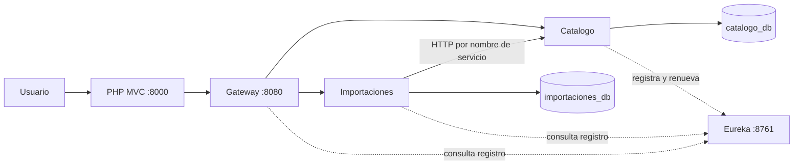
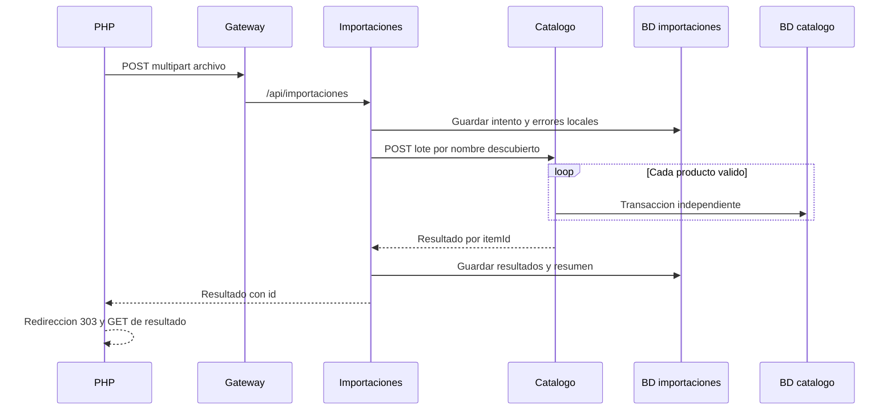
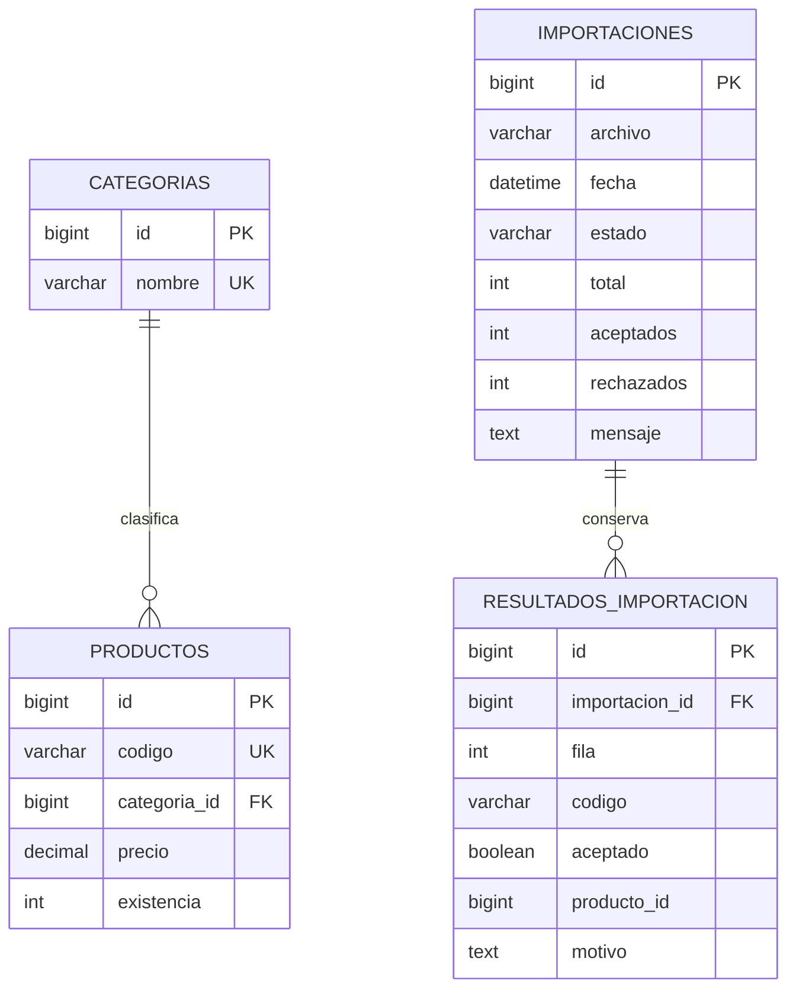

# Arquitectura y decisiones

## Responsabilidades

El sistema tiene seis procesos: PHP, Gateway, catálogo, importaciones, Eureka y MySQL. Catálogo e importaciones son los dos microservicios de negocio; Gateway y Eureka son infraestructura.

Eureka conserva instancias y señales de actividad. No transporta el POST del lote. Gateway recibe las solicitudes del frontend y selecciona un servicio. LoadBalancer resuelve el nombre lógico a una instancia.

## Recorrido de una fila

1. El navegador envía un formulario multipart a PHP.
2. El controlador comprueba recepción, extensión y tamaño.
3. ApiClient usa CURLFile y envía `archivo` a Gateway.
4. Gateway conserva la ruta `/api/importaciones`.
5. El servicio crea un intento PROCESANDO en su propia base.
6. CsvProductosReader decodifica UTF-8 estrictamente y lee los registros con Commons CSV.
7. Los errores locales conservan fila, código y motivo; los registros convertibles reciben itemId igual al número de fila.
8. Se guarda el total y los rechazos locales.
9. CatalogoClient solicita un lote a `http://catalogo-service/api/productos/lote` con un RestClient balanceado.
10. Catálogo valida cada entrada; cada registro se realiza en una transacción REQUIRES_NEW.
11. El catálogo devuelve itemId, aceptación, productoId o motivo.
12. Importaciones comprueba correspondencia, cantidades y referencias; guarda los resultados.
13. El intento termina COMPLETADA o COMPLETADA_CON_ERRORES.
14. PHP redirige con 303 al resultado guardado; actualizar esa vista realiza un GET.

## División por capas

| Capa | Función | Ejemplo |
|---|---|---|
| Controller | HTTP, parámetros y respuestas | ProductoController |
| Service | Reglas y coordinación | LoteProductosService, ImportacionCsvService |
| Repository | Persistencia y consultas | ProductoRepository |
| Entity | Representación persistente | Producto, Importacion |
| DTO | Contrato de entrada o salida | ProductoLoteRequest, ResultadoFilaResponse |
| Config | Clientes y documentación | CatalogoHttpConfig, OpenApiConfig |

PHP separa Views, Controllers, Models y Core. Sus modelos consumen APIs; no implementan repositorios SQL.

## Persistencia

Las dos parejas de tablas pertenecen a bases distintas. `producto_id` del historial es una referencia devuelta por otra API, no una relación JPA entre bases.

## Transacciones

- El coordinador de importaciones no mantiene una transacción abierta durante HTTP.
- RegistroImportacionesService guarda cada etapa mediante métodos transaccionales invocados desde otro bean.
- LoteProductosService evalúa el conjunto; RegistroProductoService tiene REQUIRES_NEW.
- La llamada entre beans pasa por el proxy de Spring. Una autollamada dentro de la misma clase no demostraría la misma frontera transaccional.
- MySQL también aplica unicidad, FK y CHECK: una consulta previa de duplicados no elimina las carreras entre solicitudes concurrentes.

No existe una transacción distribuida entre las bases. Si catálogo guarda y se pierde su respuesta, el resultado queda sin confirmar. No se reintenta automáticamente.

## Estados y contadores

| Estado | Significado |
|---|---|
| PROCESANDO | Intento creado y todavía no finalizado |
| COMPLETADA | Todas las filas fueron aceptadas |
| COMPLETADA_CON_ERRORES | Todas las filas evaluadas, al menos una rechazada |
| FALLIDA | No se pudo completar el proceso o el archivo no es procesable |

En procesos completados: total = aceptados + rechazados.
En FALLIDA puede ser menor: una fila no confirmada no equivale a una fila inválida.

## Decisiones que debes poder justificar

- BigDecimal conserva precisión decimal para precios.
- DTO evita exponer entidades y relaciones LAZY al serializador.
- JOIN FETCH obtiene categoría para construir respuestas sin una consulta adicional por producto.
- countQuery permite calcular el total paginado sin fetch.
- Validación en catálogo protege también solicitudes directas.
- Commons CSV respeta comillas y comas; split no implementa el formato.
- Dos RestClient.Builder: el normal es Primary y el balanceado se solicita con LoadBalanced. Así Eureka no intenta descubrir un servicio llamado localhost.
- Los filtros de Gateway son explícitos; registrar un servicio en Eureka no lo publica automáticamente ni lo protege contra conexiones directas.
